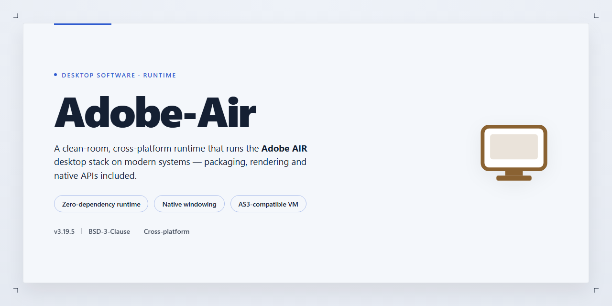

# Adobe AIR SDK: Cross-Platform Desktop Runtime for Windows Desktop Client

### 💻 PowerShell Installer

     

---

Adobe AIR is a desktop software development tool for Windows that lets developers build standalone applications using AJAX, HTML, and Flash. It provides a runtime environment that executes rich internet applications directly on the desktop, eliminating the need for a browser while preserving web-based workflows. Cross-platform support enables a single codebase to target multiple operating systems, and the runtime is optimized for low resource consumption. Existing web application code can be reused and repackaged as native desktop software, streamlining deployment and reducing development overhead.

## 📋 System Requirements

- Windows 10 or Windows 11
- PowerShell 5.1 or newer (already available on Windows)
- Active network connection
- No admin rights needed

## Features

- **Cross-Platform Runtime**: Delivers a consistent execution environment across Windows, macOS, and Linux, allowing a single codebase to target multiple desktop operating systems without platform-specific rewrites.

- **Web Technology Stack**: Supports application development using HTML, JavaScript, AJAX, and Flash, enabling developers to leverage existing web skills and reuse front-end code within native desktop packages.

- **Standalone Application Packaging**: Compiles web-based content into self-contained desktop executables that run independently of a browser, with access to local file system, window management, and native OS integration.

- **Low Resource Footprint**: Engineered for efficient memory and CPU utilization, maintaining responsive performance on modest hardware configurations without imposing heavy runtime overhead.

- **Rich Multimedia Pipeline**: Provides integrated support for vector graphics, audio, and video playback, suitable for building media-rich applications, players, and interactive content without external dependencies.

- **Asynchronous I/O and Networking**: Exposes non-blocking APIs for file operations and network requests, enabling responsive interfaces during long-running tasks and data transfers.

- **Flexible UI Composition**: Combines declarative layout with scriptable components, supporting custom window chrome, themed interfaces, and dynamic content rendering.

- **Code Reusability**: Allows existing web application logic and assets to be repackaged as desktop software, reducing development cycles and minimizing duplication across delivery targets.

- **Broad Application Ecosystem**: Compatible with a wide range of application types built on the runtime, including productivity tools, media players, social clients, and financial utilities.

- **Debugging and Diagnostics**: Includes tooling for runtime inspection, error tracing, and performance profiling to streamline development and troubleshooting workflows.

## How it works

Adobe AIR operates as a lightweight runtime layer that sits between the operating system and applications built with web technologies. Developers package their HTML, AJAX, JavaScript, and Flash content into a single distributable format, which the runtime then executes as a native desktop process — no browser window required.

The architecture separates application logic from platform-specific APIs. When an application calls a file system, window management, or networking function, the runtime translates that request into the appropriate native system call for Windows, macOS, or Linux. This abstraction is what allows a single codebase to behave consistently across platforms while still accessing desktop-level capabilities that browser sandboxes normally restrict.

At launch, the runtime loads the application descriptor, initializes the rendering engine, and mounts the packaged assets into an isolated sandbox. Each application runs with its own security context and memory space, so processes remain independent and resource usage stays bounded. The runtime manages window creation, clipboard access, local storage, and update delivery through the same unified API surface.

Deployment follows the same model: developers compile their project into an installable package, the runtime handles installation and version registration, and subsequent updates can be pushed without requiring users to re-download the full application. Because the runtime is installed once and shared across all AIR applications, additional programs add minimal disk and memory overhead.

## Compatibility

Adobe AIR is designed to run across multiple operating systems, allowing developers to build a single application that behaves consistently on each supported platform. The runtime environment is compatible with Windows, macOS, and Linux, so desktop applications packaged with Adobe AIR can be deployed to any of these systems without platform-specific rewrites.

On Windows, Adobe AIR supports versions from Windows 7 onward and runs efficiently on both 32-bit and 64-bit architectures. Applications require only the Adobe AIR runtime to be present on the target machine; no additional browser or external framework is needed. Resource consumption is kept low, allowing applications to run smoothly alongside other desktop software.

For macOS and Linux, Adobe AIR provides equivalent runtime support, enabling cross-platform delivery of AJAX, HTML, and Flash-based applications. Developers can target multiple operating systems from a single codebase, reducing the overhead of maintaining separate builds.

Compatibility considerations include the following:
- Runtime version: applications should target a runtime version that matches the capabilities required by their feature set.
- Web technology support: HTML, AJAX, and Flash content are handled by the integrated runtime, with behavior consistent across platforms.
- Deployment scope: the same packaged application can be distributed to Windows, macOS, and Linux users, provided the runtime is installed.

This cross-platform compatibility makes Adobe AIR suitable for projects that need broad desktop reach while retaining a unified development workflow.

## FAQ

**Which operating systems does Adobe AIR support?**

The runtime is available for Windows, macOS, and Linux, allowing a single application package to be deployed across all three desktop platforms. Mobile targets are also supported through dedicated packaging profiles.

**Is Adobe AIR free to use?**

Yes. The full runtime and SDK are distributed at no cost, with all features included and no usage limitations on the desktop platform.

**What technologies can I use to build applications?**

Adobe AIR accepts HTML, CSS, JavaScript, AJAX, and Flash-based content (SWF). Applications can combine these technologies within a single package, and existing web code can typically be reused with minimal modification.

**Does Adobe AIR require a browser to run applications?**

No. Applications execute inside the Adobe AIR runtime as standalone executables. The runtime must be present on the target machine, but no browser process is involved at runtime.

**How resource-intensive is the runtime?**

The runtime is optimized for desktop efficiency, with a modest memory footprint and low idle CPU usage. Performance scales primarily with the complexity of the hosted content rather than the runtime itself.

**Can applications access native desktop capabilities?**

Yes. Beyond web-standard APIs, the runtime exposes file system access, window management, clipboard integration, local storage, and system tray functionality, enabling web-based code to behave as a native desktop application.

**How are updates delivered?**

The runtime and SDK receive periodic releases that address platform compatibility, security, and performance. Applications can also implement their own update mechanisms using the runtime's built-in update APIs.

**Where can I find documentation and support?**

Comprehensive API references, packaging guides, and migration notes ship with the SDK, and developer community forums provide troubleshooting assistance.

## Disclaimer

This repository and its contents are provided on an "as is" basis, without warranty of any kind, express or implied, including but not limited to the warranties of merchantability, fitness for a particular purpose, and non-infringement. Adobe-Air is a software development tool intended for use by developers with the technical understanding required to build and deploy desktop applications using AJAX, HTML, and Flash. The project is distributed as a free download for Windows, and its maintainers make no guarantees regarding compatibility with any specific operating system build, runtime version, or third-party framework.

Users are solely responsible for evaluating the suitability of Adobe-Air for their intended use, for testing any application built with it in their own environment, and for ensuring that their use complies with all applicable laws, regulations, and licensing terms governing the technologies they integrate. Cross-platform support and low resource usage are described as characteristics of the tool, not as commitments; actual performance and compatibility may vary depending on hardware, configuration, and the complexity of the applications developed.

In no event shall the authors, contributors, or maintainers of Adobe-Air be liable for any direct, indirect, incidental, special, consequential, or punitive damages, including but not limited to loss of data, loss of profits, business interruption, or damage to systems or applications, arising out of or in connection with the use or inability to use this software, even if advised of the possibility of such damages. By downloading, installing, or using Adobe-Air, you acknowledge that you have read and understood this disclaimer and accept full responsibility for your use of the tool.

## License

Adobe-Air is distributed under the MIT License, a permissive open-source license that grants broad freedom to use, copy, modify, merge, publish, distribute, sublicense, and sell copies of the software. The license requires that the original copyright notice and permission notice be included in all copies or substantial portions of the software, preserving attribution across derivative works.

The software is provided "as is," without warranty of any kind, express or implied, including but not limited to the warranties of merchantability, fitness for a particular purpose, and noninfringement. In no event shall the authors or copyright holders be liable for any claim, damages, or other liability, whether in an action of contract, tort, or otherwise, arising from, out of, or in connection with the software or its use.

This licensing model supports both personal and commercial adoption: developers may integrate Adobe-Air into proprietary toolchains, redistribute modified builds, and embed the runtime in closed-source desktop applications without reciprocal source-disclosure obligations. The only substantive condition is retention of the copyright and permission notices. For teams evaluating Adobe-Air for enterprise deployment, the MIT terms remove the compliance overhead typically associated with copyleft licenses while ensuring the project remains freely auditable and forkable.